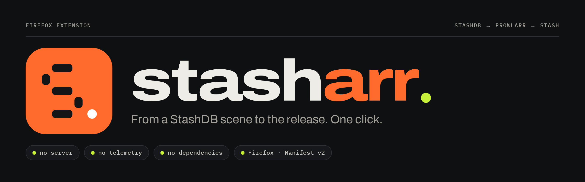
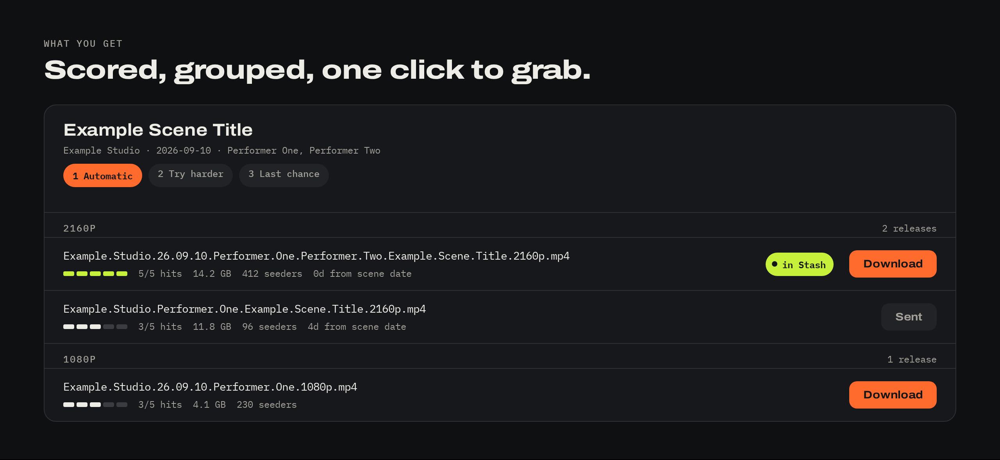

  
  
  
  

  <b><a href="#-quick-start">Quick start</a></b> ·
  <b><a href="docs/README.md">Documentation</a></b> ·
  <b><a href="docs/troubleshooting.md">Troubleshooting</a></b> ·
  <b><a href="CHANGELOG.md">Changelog</a></b>

---

**stasharr** turns any [StashDB](https://stashdb.org) scene page into a one-click [Prowlarr](https://prowlarr.com) search. It reads the scene's studio, cast and date, hunts your indexers in three escalating passes, scores what comes back and sends your pick straight to your download client.

It runs entirely inside Firefox: no server, no telemetry, just your browser talking to your own Prowlarr, your own Stash and StashDB.

> [!NOTE]
> **100 % vibe-coded.** Every line of stasharr (code, tests, design and these docs) was written by an AI (Claude) from natural-language prompts. No human wrote or reviewed the code by hand. It ships with automated tests but no warranty. Read the code before you run it.

## 🔎 What you get

| | |
|---|---|
| ⚡ **One-click search** | **Search Prowlarr** in a dock at the bottom right of every scene page. |
| 🪜 **Three escalating passes** | Narrow and precise first, wider on demand. Results only ever grow. |
| 🎯 **Scored results** | Every release is checked against 4 facts about the scene (studio, performer, title, date) and ranked. |
| 🧱 **Grouped by quality** | 2160p, 1080p, 720p, rest, with seeders, size and indexer on every row. |
| ⬇️ **One-click grab** | **Download** hands the release to Prowlarr. It turns into **Sent** so you never grab it twice. |
| 🟢 **Already in your Stash** | Badges on scene pages and scene cards, with the resolution you own. |
| 👥 **Performer sidebars** | Their other scenes in your library, right next to the scene. |
| 🔁 **Stashboard** | Download buttons and Radar for [Stashboard](https://github.com/brewing8309/stashboard) users. |
| 🕵️ **Reverse lookup** | Select any text, right-click, **Search StashDB** to find which scene it is. |
| 🔍 **Full transparency** | A **Details** pane lists every query and its raw results. No black box. |

## 🚀 Quick start

**You need:** Firefox, a running Prowlarr with at least one indexer and a StashDB account. [StashApp](https://stashapp.cc) is optional.

### 1. Install
Download `stasharr-<version>.xpi` from [Releases](https://github.com/brewing8309/stasharr/releases/latest) and drag it into a Firefox window. Confirm the prompt. From then on it updates itself.

### 2. Connect Prowlarr
`about:addons` → stasharr → **Preferences**. Enter the **Prowlarr URL** (e.g. `http://192.168.1.10:9696`, no trailing slash) and the **API key** from Prowlarr → Settings → General → Security. Press **Test Prowlarr**.

### 3. Connect Stash *(optional)*
Enter your **Stash URL** (and API key if Stash asks for one), press **Test Stash**, then **Save**. This switches on the badges and sidebars.

### 4. Search
Log in to StashDB in the same Firefox, open a scene (`stashdb.org/scenes/<id>`) and press **Search Prowlarr** in the dock. Nothing good? **Try harder**, then **Last chance**.

### 5. Download
Press **Download** on the release you want. Prowlarr passes it to your download client.

> [!TIP]
> The dock's **Auto-Download** switch sends the best release (every hit matched) automatically after a search. Leave it off until you trust your indexers.

## 📚 Documentation

| | |
|---|---|
| [Installation & updates](docs/installation.md) | Signed `.xpi`, trying a branch, signing your own fork |
| [Configuration](docs/configuration.md) | Every setting in the preferences |
| [Usage](docs/usage.md) | A scene from search to download |
| [Features](docs/features.md) | Badges, sidebars, Auto-Download, Stashboard, radar, reverse lookup |
| [How it works](docs/how-it-works.md) | Architecture, the three search stages, scoring |
| [Troubleshooting & FAQ](docs/troubleshooting.md) | Symptoms and causes, privacy, permissions |
| [Development & releasing](docs/development.md) | Layout, tests, release flow |
| [Security audit](SECURITY-AUDIT.md) | Scope, method and results of the security review |

## 🧑‍🍳 Good to know
- **Your data stays with you.** Keys live in `browser.storage.local` and are only sent to the Prowlarr and Stash URLs you typed. The manifest declares `data_collection_permissions: none`.
- **Desktop Firefox only.** It is a Manifest v2 extension; Chrome, Edge and Android are not supported.
- **It never downloads by itself.** It asks Prowlarr to grab a release; Prowlarr hands it to the client you set up there.

## 🤝 Contributing
Bug reports and ideas are welcome as [issues](https://github.com/brewing8309/stasharr/issues). Run the tests with `node --test` (Node 20+, nothing to install). Details in [Development](docs/development.md).

## 📜 License

[CC BY-NC 4.0](LICENSE): use it, change it, share it, build on it, as you like, as long as you **credit stasharr with a link to this repository** and **do not charge money for it** or use it commercially.

## ⚖️ Disclaimer

This tool searches **your own** Prowlarr instance across **your own** indexers, and talks to
**your own** Stash. It hosts nothing, indexes nothing, distributes nothing, and ships with no
indexers, trackers or sources of any kind. What you point it at, and whether you're entitled to
what you find, is entirely on you.

Not affiliated with StashDB, Stash, or Prowlarr.
