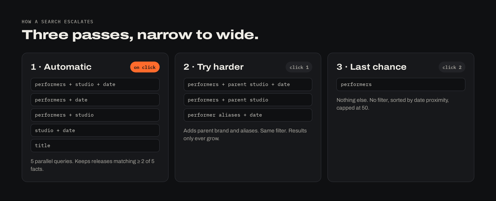

[← Documentation](README.md)

# How it works

Everything runs locally in your browser. There is no server, no telemetry, no third party — just
your Firefox talking to your Prowlarr, your Stash, and StashDB.

```
              ┌──────────────────────── Firefox ────────────────────────┐
              │                                                          │
 stashdb.org  │  content.js ──── GraphQL (your session) ──► StashDB      │
 scene page   │      │           studio · cast · aliases · parent · date │
              │      │                                                   │
              │      ▼                                                   │
              │  3-stage search ──► background.js ──────────► Prowlarr   │
              │      ▲                (all cross-origin        (search   │
              │      │                 requests proxied         + grab)  │
              │  results panel          through here)                    │
              │  scored · grouped · deduped ◄─────────────────► StashApp │
              │                                                (library  │
 any page ────┤  right-click selection ──► background.js ──► StashDB      │
 (reverse)    │              picker.js ◄── matching scenes     search)   │
              │                                                          │
              └──────────────────────────────────────────────────────────┘
```

## Permissions and trust

- **What it can reach.** stashdb.org is the only host it always has. Your Prowlarr and Stash hosts
  are optional permissions you grant on the preferences page; until then nothing is sent to them.
  The reverse lookup injects its panel into the page you right-clicked on (`activeTab`).
- **Who can ask the background script.** Only stasharr's own preferences page and its script on
  `https://stashdb.org`. The API keys are added there, in request headers, and never reach a page.
- **What stashdb.org can do.** Its scripts can see stasharr's panel and sidebars (they're part of
  its page), but clicks they fake are ignored: searching, downloading, Auto-Download and the radar
  only react to you.
- Everything from Prowlarr, Stash and StashDB is shown as text, never as HTML.

Details and remaining risks: [security audit](../SECURITY-AUDIT.md).

## The three stages


Each stage fires its queries **in parallel**, merges the responses, de-duplicates them by release
GUID, and merges them into everything found so far. Results never get thrown away when you move
up a stage — the list only ever grows.

<table>
<tr><th>Stage</th><th>Trigger</th><th>Queries</th><th>Filtering</th></tr>
<tr>
<td><b>1 — Automatic</b></td>
<td>Clicking the button</td>
<td>

`performers + studio + date`<br>
`performers + date`<br>
`performers + studio`<br>
`studio + date`<br>
`title`

</td>
<td>Must match ≥ 2 of 4 criteria</td>
</tr>
<tr>
<td><b>2 — Try harder</b></td>
<td>Click 1</td>
<td>

`performers + parent studio + date`<br>
`performers + parent studio`<br>
`performer aliases + date`

</td>
<td>Same ≥ 2 of 4 filter</td>
</tr>
<tr>
<td><b>3 — Last chance</b></td>
<td>Click 2</td>
<td>

`performers` (nothing else)

</td>
<td>No filter. Sorted by publish-date proximity, capped at 50.</td>
</tr>
</table>

Queries that would repeat something already tried — or that have nothing to fill in, like a studio
with no parent brand — are skipped rather than re-sent. After stage 3 there is nothing left to
fall back to, so the button retires itself and leaves a parting word in its place.

## Scoring

Every release title is normalised (lowercased, punctuation stripped) and checked against four
fixed facts about the scene:

**Studio** · **Performer** · **Title** · **Date**

- **Studio** matches the studio or, when the scene has one, its parent studio. Release names carry
  one or the other, rarely both, so the parent studio is not a criterion of its own.
- **Performer** matches on any cast member's name, the name she's credited as in this scene, or
  any of her aliases. Short single-word aliases are skipped for scoring, because something like
  "Mia" would match half the index.
- **Title** matches on the whole title, or on at least 60 % of its significant words. Release
  names often cut long titles short.

Stages 1 and 2 only show releases matching **at least 2 of 4** — that's what keeps the broad
queries usable. Every row shows its own score inline (`3/4 hits (Studio, Performer 2/3, Date)`),
so you can see exactly why something is in the list. With more than one performer, the
`2/3` tells you how much of the cast the release names. Within a resolution group, higher
scores rank first, then releases naming more of the cast, then seeders/grabs.

Every row also shows how far its Prowlarr publish date sits from the scene's release date
(`4d from scene date`). That's **informational only** — it never feeds the score or the sort,
except in stage 3, where it *is* the sort.
